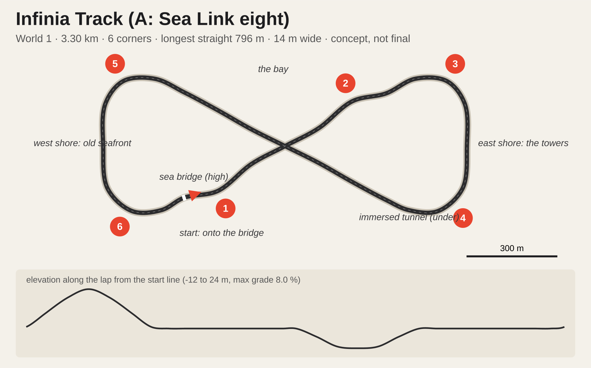
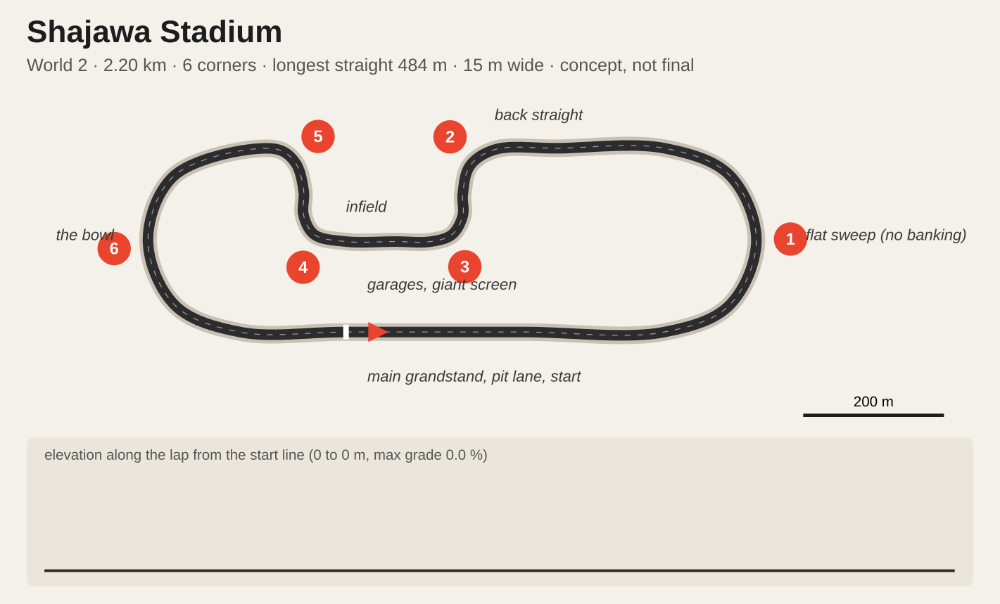

# Career worlds and four new tracks: concepts

Concepts to start the Blender work from, written on 2026-11-01. Nothing here is built. The career itself is designed in `career-mode.md`; this file fills its section 4.5 ("tracks the career wants next") and gives the career three worlds.

The plans and the numbers under them come from `docs/career-worlds/layouts.json` through `node scripts/sketch-layouts.mjs` (add `--png` for `qa/career-worlds/sheet.png`). The script closes each waypoint list with a centripetal Catmull-Rom spline, scales it to the target lap and checks corners, the longest straight, grades and how close two parts of the lap pass. `docs/career-worlds/<id>.json` is the scaled centreline for the Blender build, in metres, the same kind of closed waypoint road India V1 started from. Lap times are estimates **(assumed)** until the AI laps them.

## 1. Three worlds

A world is a chapter of the career: a region with its own look, venues and sponsors. **The world follows the player's tier.** Rookie seats race in World 1, a Maestro seat opens World 2, a Legend seat opens World 3. The grid is still all eight teams (career-mode.md, C1), so this is a story about where the series races while you are at that level, not a separate championship.

| | **World 1: The Proving Grounds** | **World 2: The Grand Tour** | **World 3: The Crown** |
|---|---|---|---|
| Tier | Rookies | Maestros | Legends |
| Idea | Working places turned into circuits for a weekend: a hill road, an airfield, a steel mill | Permanent circuits with history, press and name sponsors | Prestige venues, night races, the whole world watching |
| Tracks | India Ghat (built), **Mojave Dry Lake**, **Infinia Track** | Corniche Marina (built), **Shajawa Stadium** | Tokyo Hiragana (built), **Lago Serena** |
| Home teams | Mojave (Dry Lake), Liberty (Infinia) | Sarab (Marina); Shajawa is neutral, the series' showpiece | Hayate (Tokyo), Saetta, Toro and Aurum (Lago) |
| Venue dressing | Tyre walls, temporary stands, local sponsors | Permanent grandstands, pit buildings, hoardings | Big screens, title sponsors |
| Colour | Ochre, rust, sodium orange | Green, grey sky, sea blue | Neon, lake blue, villa gold |
| Season finale | Infinia at dusk | Marina at night | Tokyo at night (x1.5 points, as career-mode.md 4.1) |

**Calendar rule** (replaces career-mode.md 4.1's "6 rounds on all tracks" once these tracks exist): the current world's tracks run twice each, every track from earlier worlds runs once, and a season is capped at 8 rounds.

| World | Rounds | Calendar |
|---|---|---|
| 1 | 6 | India, Dry Lake, Infinia x2 each |
| 2 | 7 | Marina, Shajawa x2 each; India, Dry Lake, Infinia once |
| 3 | 8 | Tokyo, Lago x2 each; 4 of the 5 earlier tracks once (seeded) |

Until Dry Lake and Infinia exist, the MVP season stays as written in career-mode.md 4.1.

Every team has a home round (India stays the Open Shootout venue): a hook for the event deck (career-mode.md 7.4), such as a home crowd or a home team's push to win.

## 2. The four tracks at a glance

| | Mojave Dry Lake | Infinia Track | Shajawa Stadium | Lago Serena |
|---|---|---|---|---|
| World | 1 | 1 | 2 | 3 |
| Archetype (career-mode.md 4.5) | Short technical | Figure-eight: straight legs, angular loops, a bridge over a tunnel | Stadium speedway: flat oval sweeps plus an infield section | Legends showcase: fast lakeside, then switchbacks |
| Lap | 1.70 km, ~53 s | 2.10 km, ~58 s | 2.20 km, ~55 s | 2.40 km, ~68 s |
| Corners (measured) | 8 | 8 (four 90°, four 30° kinks; the east loop all rights, the west all lefts) | 6 (two long flat sweeps, four 90° infield corners) | 6 (two hairpins) |
| Longest straight | 314 m (runway) | 424 m (the climb to the bridge) | 484 m | 480 m (through the tunnel) |
| Width | 16 m | 13 m | 15 m | 13 m |
| Elevation | 0 to 5 m | -4 to +6 m (10 m at the crossing), 3.8 % max | flat (no banking, by design) | 2 to 32 m, 11.5 % max |
| Race laps at 7.5 min | 8 | 8 | 8 | 6-7 |
| Looks | day, dusk | day, dusk | day, dusk | day, dusk |
| Weather | dry; rain only at dusk (desert storm) | all | all | all |
| Career bias (power / grip / brake) | 0 / +0.3 / +0.5 | +0.4 / +0.3 / +0.6 | +0.8 / -0.2 / +0.4 | +0.3 / +0.5 / +0.3 |
| Hero shot | Driving under airliner wings at dusk | Cresting the bridge at dusk with the other leg diving into the tunnel below | Down the main straight at dusk, 360° of packed stands and the lights coming on | Villa lights coming on over the lake at dusk |

## 3. Mojave Dry Lake (World 1, Mojave's home)

**The idea.** A desert test airfield on the edge of a dry lake bed. The main straight is a runway, the pits are hangars, and the infield is an aircraft boneyard: rows of retired airliners in bare metal and faded primer, no airline liveries. The lap threads between them, under their wings.

**The lap.** From the runway start, brake hard into the 200° right hairpin (1) around a parked airliner's tail. A short chute leads into the left-right flick (2, 3) between two rows of planes, wings overhead. The long left (4) circles the water tower and drops onto the infield hook. The right hairpin (5) at the hangar corner opens onto the back straight along the hangar line. A long right (6) heads for the dirt berm, the left over its crest (7) is slightly blind, and the fast right (8) puts you back on the runway.

**Signature moments.** Under the wings in the boneyard (2, 3). The hairpin at the airliner tail, the best overtaking spot. The berm crest with the lake bed opening up beyond.

**Surfaces.** Runway concrete with tar joints for the straight; asphalt elsewhere; painted kerbs. Off track: cracked lake bed, sand and rock, Joshua trees and creosote scrub. Buttes and a far mountain ridge on the horizon, heat haze in the day.

**Dusk.** Long shadows from the planes across the track, the buttes going orange. A rainy dusk turns the runway into a mirror.

**What it needs.** Airliners are the big asset: one good model, instanced 12-20 times with variations (engines off, tail stripped, sun-faded). Downloading one needs your OK. Building it in Blender risks a placeholder look, which we have ruled out. Hangars, the tower and the water tower are simple Blender architecture.

**Watch.** The runway is wider than the track. Paint the 16 m edges clearly and make the rest run-off so the AI keeps a racing line.

## 4. Infinia Track (World 1, Liberty's home)

**The idea.** An infinity sign drawn with a ruler: a purpose-built modern test track with two angular loops joined by two long straight legs that cross in the middle. At the crossing one leg climbs onto a bridge and the other drops into a short tunnel under it, as on Tokyo's crossover. The style is clean and modern: white and grey concrete, sharp chevron kerbs, a sculptural bridge, glass and steel buildings in the loops. It is Liberty's new proving ground.

**The lap.** The start is on the south-west leg, already climbing. The straight rises 6 m onto the bridge and over the crossing, then drops into the east loop, all right-handers: a 30° kink (1), a hard 90° (2), the long east side, another 90° (3), and a kink (4) that points you back at the crossing. That leg dips 4 m into the tunnel under the bridge you crossed half a minute earlier. Then comes the west loop, the mirror image in left-handers (5-8), back onto the start straight.

**Signature moments.** The bridge crest with the other leg visible below. The tunnel under the crossing: daylight, dark, daylight. The two 90° corners at the far end of each loop, where braking from the long legs makes the overtakes.

**Surfaces.** New smooth asphalt, white painted concrete run-off, chevron kerbs, crash barriers with a clean modern face. The tunnel is short (about 60 m) and lit by a continuous light line, no spaced lamps that would strobe.

**What it needs.** The bridge (deck, piers, parapets) and the tunnel cut, both Blender kit pieces; the elevation is in the centreline already. Modern pavilions and a control building in the loops (Blender boxes with glass and steel). Day and dusk only.

**Watch.** The crossing needs its collision in two levels: the bridge deck over the tunnel road, with the tunnel walls and roof solid. The checker treats a pass under 6 m apart in height as a fault. AI cars must not mistake the other leg for theirs, which is solved by the centreline order.

## 5. Shajawa Stadium (World 2, the only stadium)

**The idea.** The game's one stadium circuit: a speedway inside a closed bowl of grandstands, the crowd on every side, an infield with the team garages and a giant four-sided screen. The grammar is the big-stadium speedway from the films (towering stands, the roar, the infield village), but the track is **flat**: no banked corners, so it drives like the rest of the game. It is the Grand Tour's showpiece and the loudest round of the season. The bowl and stands are our own design; no real venue or film set is copied.

**The lap.** The start is mid-way down the 484 m main straight, in front of the main grandstand and pit lane. The flat left sweep (1) is a long, fast 180° that rewards a clean line and the tyres. The back straight lets the engine run, then the lap dives into the infield: a hard left (2) off the back straight, a right (3) onto the infield straight past the garages and the screen, another right (4), and a left (5) back up onto the oval. The second flat sweep (6) brings you round onto the main straight.

**Signature moments.** The first sweep with the stands towering on the outside. The brake from top speed into the infield (2), the best overtaking spot. The infield straight under the giant screen, the crowd on both sides.

**The bowl.** Stands all the way round the oval, 25-40 m tall, steeper and taller behind the main straight, with a canopy ring, vomitories, and light towers above the rim. A pit lane and garage block along the main straight; team transporters and hospitality in the infield. Day under a hard sky; at dusk the stadium lights come on as glow (no night race, so no lighting rig to pay for).

**What it needs.** The stands are the big asset. Recommended start: the CC BY **Modular Stadium** (davi.pereira.souza, Sketchfab, 98k triangles), whose concrete stand sections we cut and array around the bowl, plus the CC BY **Stadium Light** (thundermind) for the light towers. Both need your OK to download and are credited in game. Seats and crowd are textures and cards on the tiers, not modelled one by one. The crowd reuses the game's existing stand crowd system if it fits the frame budget.

**Watch.** A closed bowl is a lot of geometry in view at once, the main performance risk of the four tracks: the stands are one mesh per material, the crowd is cards, and far tiers drop detail. The flat sweeps must still read as fast; kerbs and run-off sized for 160 km/h, not hairpins.

## 6. Lago Serena (World 3, the Italian teams' home)

**The idea.** An Alpine lake in northern Italy: a lakeside promenade, a rock tunnel, villas stepping up the hill in terraced gardens, cypress and stone pines, a campanile, a stone arch bridge over a ravine, and mahogany runabouts in the harbour. Steep mountains drop into the water behind. It is the Legends' prestige stop.

**The lap.** The lap starts by the harbour and runs flat out along the lake through the tunnel, then brakes into a 170° left (1) at the tunnel mouth. Three switchbacks climb through the villas: a right hairpin (2) and a left hairpin (3), each leg climbing. The top leg runs fast across the hillside, over the stone bridge and past the campanile. The left (4) at the far end starts the descent esses (5), and the left (6) drops back onto the promenade.

**Signature moments.** The tunnel exit into the hard stop with the lake on your right. The switchbacks between villa walls. Dusk: villa windows and string lights doubled in the lake.

**Surfaces.** Smooth asphalt, stone setts at the harbour, stone walls and balustrades, plaster villas with terracotta roofs, rock faces.

**Dusk.** Villa windows and promenade lamps coming on, harbour lights on the water. Rain at dusk is the hero look: the lake and the road both reflect.

**What it needs.** A villa kit in Blender (plaster, shutters, roof tiles, balustrades) dressed in many combinations; cypress and pine tree cards (India's tree method); Marina's water for the lake; India's terrain method for the mountains. Runabout boats need a model (download OK needed).

**Watch.** **The tunnel stays closed with a continuous light line.** Arched windows or spaced lamps would strobe at 250 km/h, the hard-blinking look we've ruled out. Lake reflections are the main performance risk (section 8).

## 7. Build order

1. **Mojave Dry Lake.** Flat, open and small: the fastest way to prove the new-track pipeline end to end (Blender build, `track.json` with centreline, `lapLength`, `corners`, 8 `gridSlots`, `sectors` and `weather.looks`, a `TRACKS` entry in `src/tracks.js`, collision, AI laps). Only the airliner model is a real asset question.
2. **Infinia Track.** It completes World 1, so the career MVP gets its own calendar.
3. **Shajawa Stadium.** The bowl is one big asset (a CC stand kit, cut and arrayed); the track itself is flat and simple.
4. **Lago Serena.** The most assets and the hardest lighting; last, when the pipeline is proven.

## 8. Budgets every new track meets

- **Day and dusk only.** The new tracks have two looks, chosen by the career story for each round; no night lighting to build or pay for (decided 2026-11-01).
- Frame time within India's measured day bench (1600x900, dynamic resolution off): ≤ 9.9 ms. These tracks are smaller, so they should come in under.
- Materials through the India material layer (`src/venue/india/materials.js`, per-surface rules, KTX2 CC0 sets) rather than plain vertex colours; that is what fixed India's plastic look. Every road gets the shared wet shader.
- Race-watch: one lap per look and weather with 0 dark frames and no stops, pull-ins or hidden cars; `test-track` static checks and the lamp check pass.
- No flicker or hard blinking anywhere: lamps, turbines, tunnels.
- No placeholder-looking props: a prop that can't be made convincing in Blender is downloaded (with your OK) or left out.

## 9. Open questions

1. Should worlds follow the player's tier (my recommendation), or should seasons visit the worlds in a fixed order whatever his seat?
2. Shajawa has no home team (Corvid's was Kestrel Downs): give it one, or keep it the neutral showpiece?
3. Airliners for Dry Lake and boats for Lago: download free models (each with your OK) or try Meshy (paid)?
4. Poly Haven CC0 texture sets the new surfaces need (lake bed, brick, setts, rusty metal, terracotta, rock): OK to download them when each build starts?
5. Are the names right (Mojave Dry Lake, Infinia Track, Shajawa Stadium, Lago Serena; The Proving Grounds, The Grand Tour, The Crown)?
