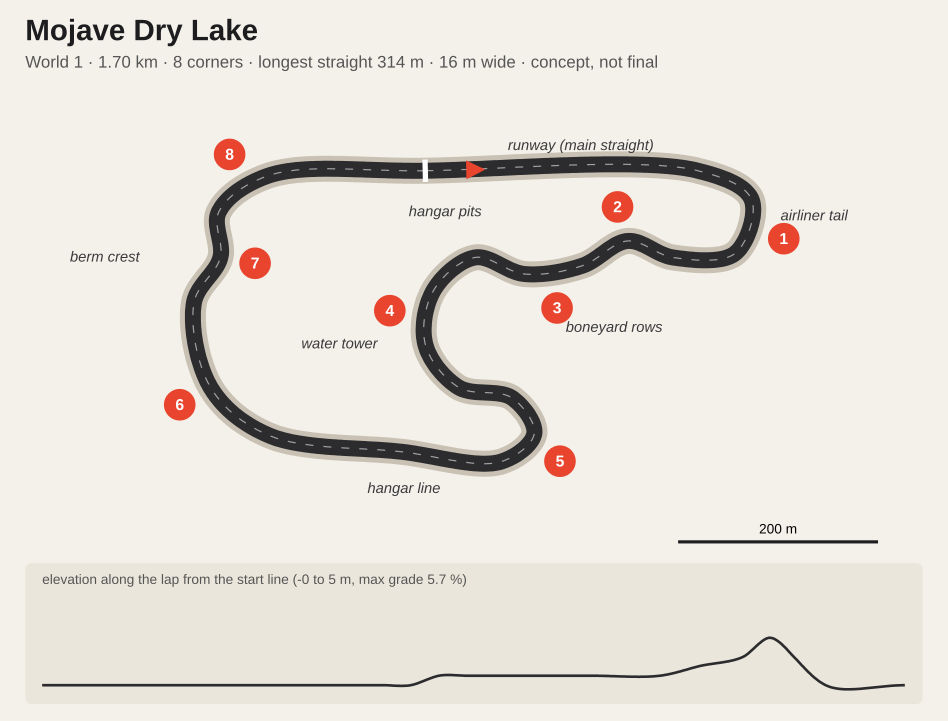
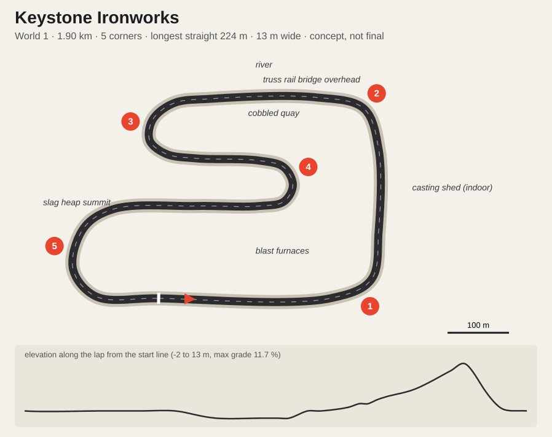
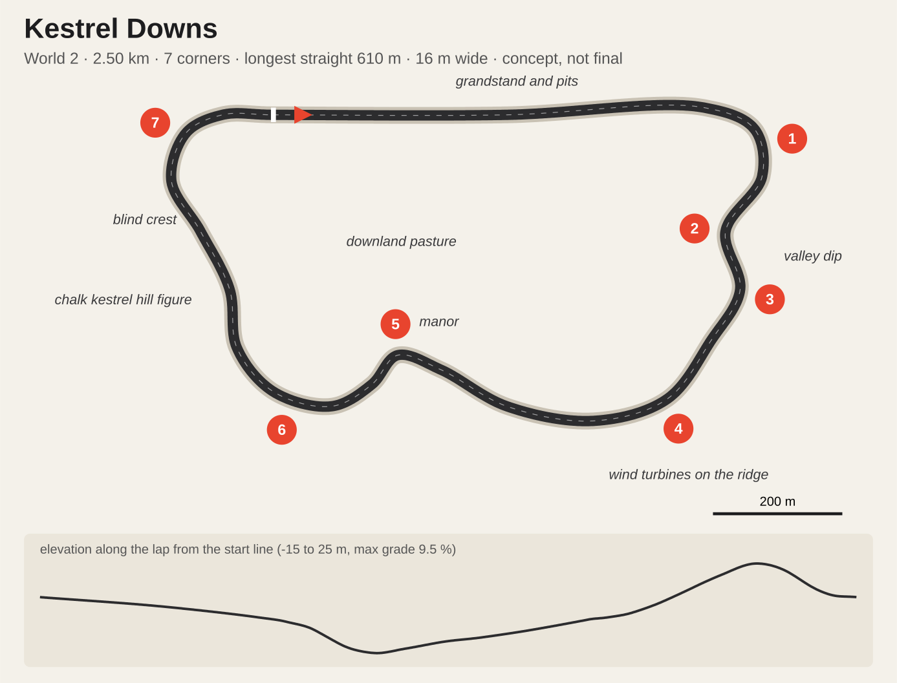
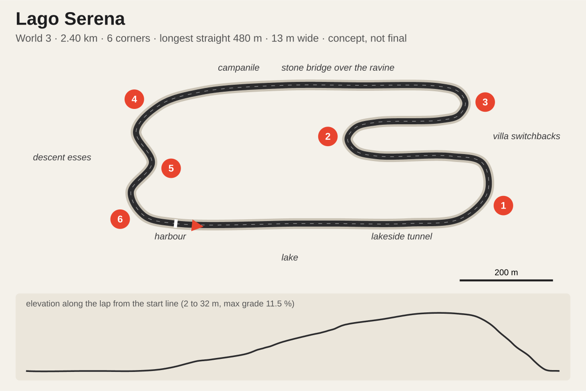

# Career worlds and four new tracks: concepts

Concepts to start the Blender work from, written on 2026-11-01. Nothing here is built. The career itself is designed in `career-mode.md`; this file fills its section 4.5 ("tracks the career wants next") and gives the career three worlds.

The plans and the numbers under them come from `docs/career-worlds/layouts.json` through `node scripts/sketch-layouts.mjs` (add `--png` for `qa/career-worlds/sheet.png`). The script closes each waypoint list with a centripetal Catmull-Rom spline, scales it to the target lap and checks corners, the longest straight, grades and how close two parts of the lap pass. `docs/career-worlds/<id>.json` is the scaled centreline for the Blender build, in metres, the same kind of closed waypoint road India V1 started from. Lap times are estimates **(assumed)** until the AI laps them.

## 1. Three worlds

A world is a chapter of the career: a region with its own look, venues and sponsors. **The world follows the player's tier.** Rookie seats race in World 1, a Maestro seat opens World 2, a Legend seat opens World 3. The grid is still all eight teams (career-mode.md, C1), so this is a story about where the series races while you are at that level, not a separate championship.

| | **World 1: The Proving Grounds** | **World 2: The Grand Tour** | **World 3: The Crown** |
|---|---|---|---|
| Tier | Rookies | Maestros | Legends |
| Idea | Working places turned into circuits for a weekend: a hill road, an airfield, a steel mill | Permanent circuits with history, press and name sponsors | Prestige venues, night races, the whole world watching |
| Tracks | India Ghat (built), **Mojave Dry Lake**, **Keystone Ironworks** | Corniche Marina (built), **Kestrel Downs** | Tokyo Hiragana (built), **Lago Serena** |
| Home teams | Mojave (Dry Lake), Liberty (Ironworks) | Sarab (Marina), Corvid (Kestrel) | Hayate (Tokyo), Saetta, Toro and Aurum (Lago) |
| Venue dressing | Tyre walls, temporary stands, local sponsors | Permanent grandstands, pit buildings, hoardings | Big screens, title sponsors |
| Colour | Ochre, rust, sodium orange | Green, grey sky, sea blue | Neon, lake blue, villa gold |
| Season finale | Ironworks at dusk | Marina at night | Tokyo at night (x1.5 points, as career-mode.md 4.1) |

**Calendar rule** (replaces career-mode.md 4.1's "6 rounds on all tracks" once these tracks exist): the current world's tracks run twice each, every track from earlier worlds runs once, and a season is capped at 8 rounds.

| World | Rounds | Calendar |
|---|---|---|
| 1 | 6 | India, Dry Lake, Ironworks x2 each |
| 2 | 7 | Marina, Kestrel x2 each; India, Dry Lake, Ironworks once |
| 3 | 8 | Tokyo, Lago x2 each; 4 of the 5 earlier tracks once (seeded) |

Until Dry Lake and Ironworks exist, the MVP season stays as written in career-mode.md 4.1.

Every team has a home round (India stays the Open Shootout venue): a hook for the event deck (career-mode.md 7.4), such as a home crowd or a home team's push to win.

## 2. The four tracks at a glance

| | Mojave Dry Lake | Keystone Ironworks | Kestrel Downs | Lago Serena |
|---|---|---|---|---|
| World | 1 | 1 | 2 | 3 |
| Archetype (career-mode.md 4.5) | Short technical | Slide track | Fast flowing | Legends showcase: fast lakeside, then switchbacks |
| Lap | 1.70 km, ~53 s | 1.90 km, ~65 s | 2.50 km, ~60 s | 2.40 km, ~68 s |
| Corners (measured) | 8 | 5 (two hairpins, a long left over the summit) | 7 | 6 (two hairpins) |
| Longest straight | 314 m (runway) | 224 m (casting shed) | 610 m | 480 m (through the tunnel) |
| Width | 16 m | 13 m | 16 m | 13 m |
| Elevation | 0 to 5 m | -2 to 13 m, 11.7 % max | -15 to 25 m, 9.5 % max | 2 to 32 m, 11.5 % max |
| Race laps at 7.5 min | 8 | 7 | 7-8 | 6-7 |
| Looks | day, dusk | day, dusk | day, dusk | day, dusk |
| Weather | dry; rain only at dusk (desert storm) | damp and rain common | damp is its home weather | all |
| Career bias (power / grip / brake) | 0 / +0.3 / +0.5 | -0.5 / +0.8 / +0.3 | +0.8 / 0 / +0.5 | +0.3 / +0.5 / +0.3 |
| Hero shot | Driving under airliner wings at dusk | Dusk through the casting shed, furnace glow | Over the blind crest past the chalk kestrel in drizzle | Villa lights coming on over the lake at dusk |

## 3. Mojave Dry Lake (World 1, Mojave's home)

**The idea.** A desert test airfield on the edge of a dry lake bed. The main straight is a runway, the pits are hangars, and the infield is an aircraft boneyard: rows of retired airliners in bare metal and faded primer, no airline liveries. The lap threads between them, under their wings.

**The lap.** From the runway start, brake hard into the 200° right hairpin (1) around a parked airliner's tail. A short chute leads into the left-right flick (2, 3) between two rows of planes, wings overhead. The long left (4) circles the water tower and drops onto the infield hook. The right hairpin (5) at the hangar corner opens onto the back straight along the hangar line. A long right (6) heads for the dirt berm, the left over its crest (7) is slightly blind, and the fast right (8) puts you back on the runway.

**Signature moments.** Under the wings in the boneyard (2, 3). The hairpin at the airliner tail, the best overtaking spot. The berm crest with the lake bed opening up beyond.

**Surfaces.** Runway concrete with tar joints for the straight; asphalt elsewhere; painted kerbs. Off track: cracked lake bed, sand and rock, Joshua trees and creosote scrub. Buttes and a far mountain ridge on the horizon, heat haze in the day.

**Dusk.** Long shadows from the planes across the track, the buttes going orange. A rainy dusk turns the runway into a mirror.

**What it needs.** Airliners are the big asset: one good model, instanced 12-20 times with variations (engines off, tail stripped, sun-faded). Downloading one needs your OK. Building it in Blender risks a placeholder look, which we have ruled out. Hangars, the tower and the water tower are simple Blender architecture.

**Watch.** The runway is wider than the track. Paint the 16 m edges clearly and make the rest run-off so the AI keeps a racing line.

## 4. Keystone Ironworks (World 1, Liberty's home)

**The idea.** A shut riverside steel mill in the East-coast rust belt, opened up for one weekend: blast furnaces, conveyor gantries, brick sheds with broken windows, a truss rail bridge over the river and a slag heap with the city across the water. Grit is the theme, and Liberty "tolerates grit".

**The lap.** The start straight runs between brick sheds. The left (1) at the shed corner sends you **through the casting shed**: an indoor straight under hanging lamps and crane rails, shafts of light by day. A fast left (2) drops onto the riverside quay, which is cobbled and low grip and runs under the rail bridge. The left hairpin (3) wraps around a crane base, and after a short leg the right hairpin (4) starts the climb up the slag heap ramp. At the top, a long left (5) goes over the summit with the skyline ahead, then down to the start.

**Signature moments.** The shed (light changes, sound echoes). Two hairpins stacked on top of each other, the drift section and the host for Drift Attack sponsor days. The summit with the city across the river.

**Surfaces.** Old concrete slabs with expansion joints, cobbled setts on the quay (meant to be the lowest grip in the game), asphalt patches. Rust, brick, oil-stained concrete, puddles that stay in Damp.

**Dusk (the hero look).** The sodium lamps just on, one furnace lit for show, steam from the quench tower against the sunset. In the rain the concrete shines.

**What it needs.** Industrial geometry suits Blender kit-building: furnace, stacks, gantries, cranes, truss bridge, sheds. New textures: brick, setts, rusty metal and worn concrete slabs (CC0 sets, download OK needed).

**Watch.** Indoors the sky light must not leak in; give the shed its own lighting. The hairpin stack has 74 m between legs, so it needs walls, not open run-off.

## 5. Kestrel Downs (World 2, Corvid's home)

**The idea.** A fast English downland circuit on an old airfield perimeter: rolling chalk hills, hedgerows, dry-stone walls, a manor on a rise, wind turbines on the ridge, and a chalk hill figure of a kestrel cut into the slope. Grey skies and drizzle are its normal weather.

**The lap.** The 610 m main straight runs slightly downhill past the grandstand. The heavy braking into the right (1) is a big stop from top speed. Then the road drops into the valley: a left (2) into the dip and its compression, and a fast right (3) out of it. The long right (4) sweeps under the turbines and leads to the left (5) at the manor. A long climbing right (6) up the down ends at the blind crest past the chalk kestrel. The fast right (7) comes back downhill onto the straight.

**Signature moments.** The braking zone into 1. The compression in the valley dip. Cresting blind with the chalk kestrel filling the screen.

**Surfaces.** Grippy asphalt with a lot of camber and crests; grass run-off, chalk where the turf wears through, gravel traps. India's stone walls and grass work here.

**Light.** Overcast day and dusk. Damp is the default weather, since this is where the wet shader earns its keep.

**What it needs.** Manor (Blender), turbines (Blender), hedgerow cards, the chalk figure as a decal on the hillside (our own design, a kestrel silhouette). Few unique assets: the terrain does the work.

**Watch.** On the blind crest (6/7), check the AI line and the chase camera. Wind turbines turn slowly and steadily: never a flicker of blade shadows over the camera.

## 6. Lago Serena (World 3, the Italian teams' home)

**The idea.** An Alpine lake in northern Italy: a lakeside promenade, a rock tunnel, villas stepping up the hill in terraced gardens, cypress and stone pines, a campanile, a stone arch bridge over a ravine, and mahogany runabouts in the harbour. Steep mountains drop into the water behind. It is the Legends' prestige stop.

**The lap.** The lap starts by the harbour and runs flat out along the lake through the tunnel, then brakes into a 170° left (1) at the tunnel mouth. Three switchbacks climb through the villas: a right hairpin (2) and a left hairpin (3), each leg climbing. The top leg runs fast across the hillside, over the stone bridge and past the campanile. The left (4) at the far end starts the descent esses (5), and the left (6) drops back onto the promenade.

**Signature moments.** The tunnel exit into the hard stop with the lake on your right. The switchbacks between villa walls. Dusk: villa windows and string lights doubled in the lake.

**Surfaces.** Smooth asphalt, stone setts at the harbour, stone walls and balustrades, plaster villas with terracotta roofs, rock faces.

**Dusk.** Villa windows and promenade lamps coming on, harbour lights on the water. Rain at dusk is the hero look: the lake and the road both reflect.

**What it needs.** A villa kit in Blender (plaster, shutters, roof tiles, balustrades) dressed in many combinations; cypress and pine tree cards (India's tree method); Marina's water for the lake; India's terrain method for the mountains. Runabout boats need a model (download OK needed).

**Watch.** **The tunnel stays closed with a continuous light line.** Arched windows or spaced lamps would strobe at 250 km/h, the hard-blinking look we've ruled out. Lake reflections are the main performance risk (section 8).

## 7. Build order

1. **Mojave Dry Lake.** Flat, open and small: the fastest way to prove the new-track pipeline end to end (Blender build, `track.json` with centreline, `lapLength`, `corners`, 8 `gridSlots`, `sectors` and `weather.looks`, a `TRACKS` entry in `src/tracks.js`, collision, AI laps). Only the airliner model is a real asset question.
2. **Keystone Ironworks.** It completes World 1, so the career MVP gets its own calendar.
3. **Kestrel Downs.** The terrain-led track, with few unique assets.
4. **Lago Serena.** The most assets and the hardest lighting; last, when the pipeline is proven.

## 8. Budgets every new track meets

- **Day and dusk only.** The new tracks have two looks, chosen by the career story for each round; no night lighting to build or pay for (decided 2026-11-01).
- Frame time within India's measured day bench (1600x900, dynamic resolution off): ≤ 9.9 ms. These tracks are smaller, so they should come in under.
- Materials through the India material layer (`src/venue/india/materials.js`, per-surface rules, KTX2 CC0 sets) rather than plain vertex colours; that is what fixed India's plastic look. Every road gets the shared wet shader.
- Race-watch: one lap per look and weather with 0 dark frames and no stops, pull-ins or hidden cars; `test-track` static checks and the lamp check pass.
- No flicker or hard blinking anywhere: lamps, turbines, tunnels.
- No placeholder-looking props: a prop that can't be made convincing in Blender is downloaded (with your OK) or left out.

## 9. Open questions

1. Should worlds follow the player's tier (my recommendation), or should seasons visit the worlds in a fixed order whatever his seat?
2. Four tracks, or three for now? If three, drop Kestrel Downs: World 2 then runs Marina plus the World 1 tracks, which is thin, so I'd keep all four.
3. Airliners for Dry Lake and boats for Lago: download free models (each with your OK) or try Meshy (paid)?
4. Poly Haven CC0 texture sets the new surfaces need (lake bed, brick, setts, rusty metal, terracotta, rock): OK to download them when each build starts?
5. Are the names right (Mojave Dry Lake, Keystone Ironworks, Kestrel Downs, Lago Serena; The Proving Grounds, The Grand Tour, The Crown)?
