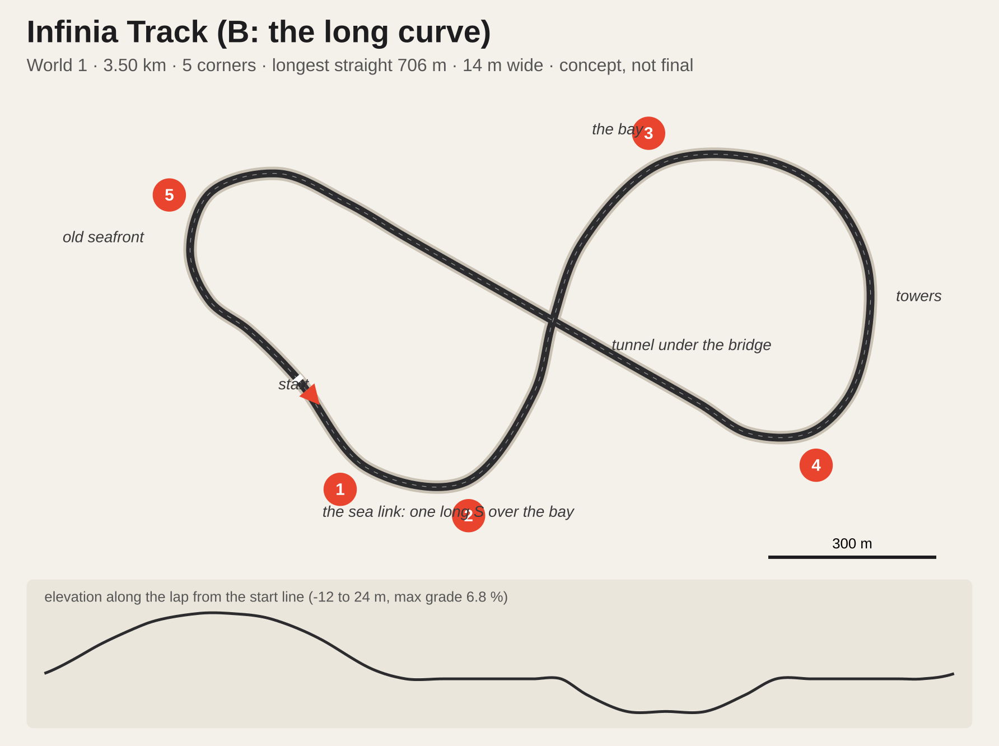
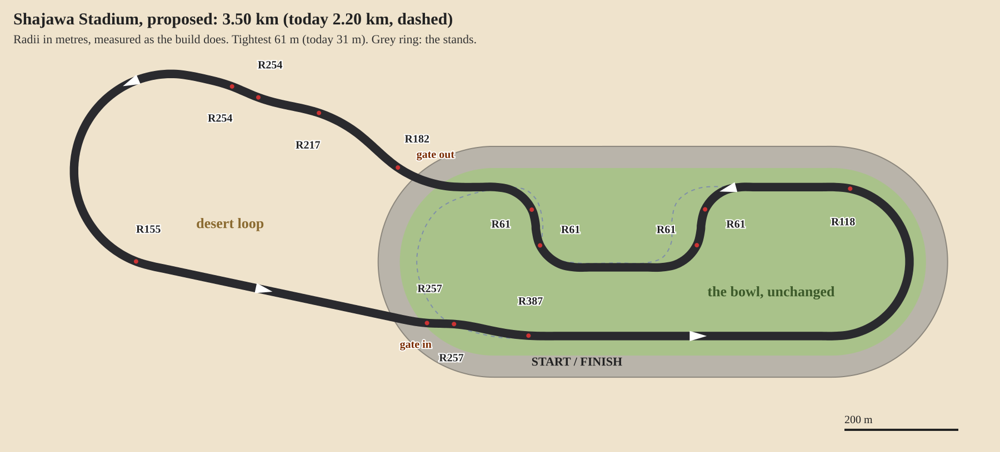
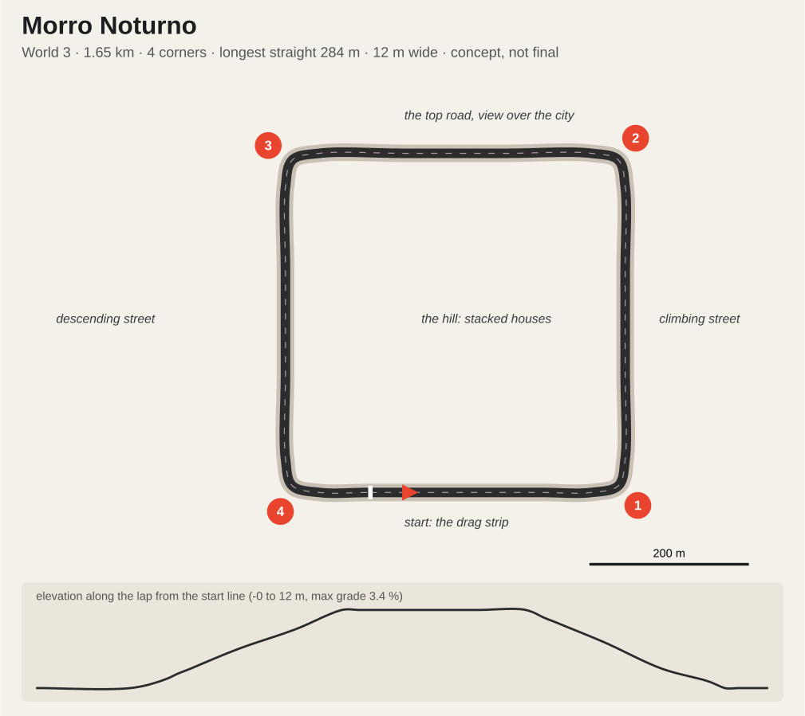

# Career worlds and four new tracks: concepts

Concepts to start the Blender work from, written on 2026-11-01. Nothing here is built. The career itself is designed in `career-mode.md`; this file fills its section 4.5 ("tracks the career wants next") and gives the career three worlds.

The plans and the numbers under them come from `docs/career-worlds/layouts.json` through `node scripts/sketch-layouts.mjs` (add `--png` for `qa/career-worlds/sheet.png`). The script closes each waypoint list with a centripetal Catmull-Rom spline, scales it to the target lap and checks corners, the longest straight, grades and how close two parts of the lap pass. `docs/career-worlds/<id>.json` is the scaled centreline for the Blender build, in metres, the same kind of closed waypoint road India V1 started from. Lap times are estimates **(assumed)** until the AI laps them.

## 1. Three worlds

A world is a chapter of the career: a region with its own look, venues and sponsors. **The world follows the player's tier.** Rookie seats race in World 1, a Maestro seat opens World 2, a Legend seat opens World 3. The grid is still all eight teams (career-mode.md, C1), so this is a story about where the series races while you are at that level, not a separate championship.

| | **World 1: The Proving Grounds** | **World 2: The Grand Tour** | **World 3: The Crown** |
|---|---|---|---|
| Tier | Rookies | Maestros | Legends |
| Idea | Working places turned into circuits for a weekend: a hill road, an airfield, a steel mill | Permanent circuits with history, press and name sponsors | Prestige venues, night races, the whole world watching |
| Tracks | India Ghat (built), **Mojave Dry Lake**, **Infinia Track** | Corniche Marina (built), **Shajawa Stadium** | Tokyo Hiragana (built), **Morro Noturno** |
| Home teams | Mojave (Dry Lake), Liberty (Infinia) | Sarab (Marina); Shajawa is neutral, the series' showpiece | Hayate (Tokyo); Morro Noturno is the Legends' night, no home team |
| Venue dressing | Tyre walls, temporary stands, local sponsors | Permanent grandstands, pit buildings, hoardings | Big screens, title sponsors |
| Colour | Ochre, rust, sodium orange | Green, grey sky, sea blue | Neon, lake blue, villa gold |
| Season finale | Infinia at dusk | Marina at night | Tokyo at night (x1.5 points, as career-mode.md 4.1) |

**Calendar rule** (replaces career-mode.md 4.1's "6 rounds on all tracks" once these tracks exist): the current world's tracks run twice each, every track from earlier worlds runs once, and a season is capped at 8 rounds.

| World | Rounds | Calendar |
|---|---|---|
| 1 | 6 | India, Dry Lake, Infinia x2 each |
| 2 | 7 | Marina, Shajawa x2 each; India, Dry Lake, Infinia once |
| 3 | 8 | Tokyo, Morro x2 each; 4 of the 5 earlier tracks once (seeded) |

Until Dry Lake and Infinia exist, the MVP season stays as written in career-mode.md 4.1.

Every team has a home round (India stays the Open Shootout venue): a hook for the event deck (career-mode.md 7.4), such as a home crowd or a home team's push to win.

## 2. The four tracks at a glance

| | Mojave Dry Lake | Infinia Track | Shajawa Stadium | Morro Noturno |
|---|---|---|---|---|
| World | 1 | 1 | 2 | 3 |
| Archetype (career-mode.md 4.5) | Short technical | Figure-eight across a bay: a cable-stayed sea bridge over an immersed tunnel | Stadium speedway: flat oval sweeps plus an infield section | Night street circuit: a rounded square of drag-strip straights round a hill |
| Lap | 1.70 km, ~53 s | 3.30-3.50 km, ~80 s | 2.20 km, ~55 s | 1.65 km, ~50 s |
| Corners (measured) | 8 | 5-6, mostly fast; two shore loops | 6 (two long flat sweeps, four 90° infield corners) | 4 tight 90° lefts (r ~21 m), one per block corner |
| Longest straight | 314 m (runway) | 700-800 m (the sea legs) | 484 m | 284 m |
| Width | 16 m | 14 m | 15 m | 12 m (city streets) |
| Elevation | 0 to 5 m | -12 m (tunnel) to +24 m (bridge), 8 % max | flat (no banking, by design) | 0 to 12 m: one street climbs, the opposite one descends; 3.4 % max |
| Race laps at 7.5 min | 8 | 5-6 | 8 | 9 |
| Looks | day, dusk | day, dusk | day, dusk | night only (the exception) |
| Weather | dry; rain only at dusk (desert storm) | all | all | wet streets every round (damp or rain) |
| Career bias (power / grip / brake) | 0 / +0.3 / +0.5 | +0.4 / +0.3 / +0.6 | +0.8 / -0.2 / +0.4 | +0.6 / +0.4 / +0.6 |
| Hero shot | Driving under airliner wings at dusk | Dusk on the sea bridge, cable lights on, the tunnel portals far below | Down the main straight at dusk, 360° of packed stands and the lights coming on | Launching down the drag strip at night, neon and wet tarmac, the lit hill above |

## 3. Mojave Dry Lake (World 1, Mojave's home)

**The idea.** A desert test airfield on the edge of a dry lake bed. The main straight is a runway, the pits are hangars, and the infield is an aircraft boneyard: rows of retired airliners in bare metal and faded primer, no airline liveries. The lap threads between them, under their wings.

**The lap.** From the runway start, brake hard into the 200° right hairpin (1) around a parked airliner's tail. A short chute leads into the left-right flick (2, 3) between two rows of planes, wings overhead. The long left (4) circles the water tower and drops onto the infield hook. The right hairpin (5) at the hangar corner opens onto the back straight along the hangar line. A long right (6) heads for the dirt berm, the left over its crest (7) is slightly blind, and the fast right (8) puts you back on the runway.

**Signature moments.** Under the wings in the boneyard (2, 3). The hairpin at the airliner tail, the best overtaking spot. The berm crest with the lake bed opening up beyond.

**Surfaces.** Runway concrete with tar joints for the straight; asphalt elsewhere; painted kerbs. Off track: cracked lake bed, sand and rock, Joshua trees and creosote scrub. Buttes and a far mountain ridge on the horizon, heat haze in the day.

**Dusk.** Long shadows from the planes across the track, the buttes going orange. A rainy dusk turns the runway into a mirror.

**What it needs.** Airliners are the big asset: one good model, instanced 12-20 times with variations (engines off, tail stripped, sun-faded). Downloading one needs your OK. Building it in Blender risks a placeholder look, which we have ruled out. Hangars, the tower and the water tower are simple Blender architecture.

**Watch.** The runway is wider than the track. Paint the 16 m edges clearly and make the rest run-off so the AI keeps a racing line.

## 4. Infinia: the main India circuit (sea link)

**The decision (2026-11-01).** Infinia grows into the game's main India circuit, 4.8-5.0 km like Marina (5.47) and Tokyo (5.18). India Ghat (2.99 km) stays as the smaller India map. The figure-eight and its central crossing stay: one leg is a sea link over the bay, the other an undersea tunnel beneath it.

**What it takes from real India (research brief, 2026-11-01).**
- *Bandra-Worli Sea Link, Mumbai:* 5.6 km, 250 m cable-stayed main spans, a diamond inverted-Y tower about 126 m tall, 8 lanes. Ours: a shorter link (about 1 km over the water at game scale) with one tall diamond inverted-Y tower and fans of stays, our own design.
- *Mumbai Coastal Road:* India's first undersea twin tunnels, 17-20 m below sea level. Ours: the tunnel leg, 12 m under the bay, one continuous light line, a warm sodium palette after the sea glare.
- *Buddh International Circuit:* 5.125 km, a straight over 1 km with a dip and climb, the banked multi-apex T10-12. Ours: the towers' long straight with a dip and climb (A) and one multi-apex sweeper.
- *Hyderabad street circuit:* a lakeside chicane where the run-off could not grow. *Chennai street circuit:* a night street race past colonial landmarks. Ours: a chicane in the art-deco streets, a lakeside hook in the old city (B).
- *Mumbai cues:* Marine Drive's long curve of streetlights (the Queen's Necklace from above), art-deco seafront blocks, black-and-yellow taxis and auto-rickshaws (generic), fishing boats, sea-wall promenade, monsoon rain, festival crowds.

**A, the Necklace eight (4.80 km).** The start is in the art-deco streets, through a chicane, straight onto the sea link: 22 m up over the bay, the tower overhead. It lands in the towers district: a 970 m straight with a dip and climb, then the multi-apex sweeper, and down into the undersea tunnel under the bridge. It comes up on the seafront for the Necklace, a 900 m curve along the bay under the streetlights, back to the start. Balanced: fast bridge, a big straight, a flowing seafront.

**B, the long S (5.00 km).** The sea link is one long S over the water, the way the real link sweeps across the bay, and the longest straight in the game (1.1 km). The east loop is the old city: tight streets, chicanes and a lakeside hook. Then towers, the tunnel and the Necklace as in A. More of a street circuit, with the bridge as a pure speed run.

**Looks.** As a main circuit it should have all four looks like Marina, Tokyo and India Ghat: dusk on the bridge, and night on the Necklace with its streetlights, are the heroes. (The day-and-dusk rule was for the small career tracks.)

**What it needs.** The bridge kit (deck, diamond tower, stays, parapets), the tunnel (portals, tiled walls, light line, two-level collision at the crossing), the sea (Marina's water), the seafront (sea wall, promenade, art-deco blocks), the towers district, the old city streets; distant skylines as photographed arcs. The biggest build of the four.

**Llano Speedway (World 2, added to the calendar 2026-11-02 at the user's call):** `tracks/llano`, par 117.5 s, day and dusk, a home track of World 2 beside Marina and Shajawa.

## 5. Shajawa Stadium (World 2, the only stadium)

**Relaid 2026-11-04 at the user's call (over the sections below, which describe the first 2.2 km oval):** 3.5 km (`career-worlds/shajawa_b.json`), par 62.3 s, tightest corner R61 (it was R31), the rest R118 or wider. A 3.5 km lap in the bowl would need a 1.4 km stadium, so the bowl stays where it was and the road leaves it through a marathon gate in the north-west stand, runs a 1.5 km desert loop and comes back through a gate in the south-west stand. Gulf sponsors on the boards (Aramco, Emirates, ADNOC, Saudia, stc, SABIC, DP World). Saved best laps on the old layout are cleared once on load.

**The idea.** The game's one stadium circuit: a speedway inside a closed bowl of grandstands, the crowd on every side, an infield with the team garages and a giant four-sided screen. The grammar is the big-stadium speedway from the films (towering stands, the roar, the infield village), but the track is **flat**: no banked corners, so it drives like the rest of the game. It is the Grand Tour's showpiece and the loudest round of the season. The bowl and stands are our own design; no real venue or film set is copied.

**The lap.** The start is mid-way down the 484 m main straight, in front of the main grandstand and pit lane. The flat left sweep (1) is a long, fast 180° that rewards a clean line and the tyres. The back straight lets the engine run, then the lap dives into the infield: a hard left (2) off the back straight, a right (3) onto the infield straight past the garages and the screen, another right (4), and a left (5) back up onto the oval. The second flat sweep (6) brings you round onto the main straight.

**Signature moments.** The first sweep with the stands towering on the outside. The brake from top speed into the infield (2), the best overtaking spot. The infield straight under the giant screen, the crowd on both sides.

**The bowl.** Stands all the way round the oval, 25-40 m tall, steeper and taller behind the main straight, with a canopy ring, vomitories, and light towers above the rim. A pit lane and garage block along the main straight; team transporters and hospitality in the infield. Day under a hard sky; at dusk the stadium lights come on as glow (no night race, so no lighting rig to pay for).

**What it needs.** The stands are the big asset. Recommended start: the CC BY **Modular Stadium** (davi.pereira.souza, Sketchfab, 98k triangles), whose concrete stand sections we cut and array around the bowl, plus the CC BY **Stadium Light** (thundermind) for the light towers. Both need your OK to download and are credited in game. Seats and crowd are textures and cards on the tiers, not modelled one by one. The crowd reuses the game's existing stand crowd system if it fits the frame budget.

**Watch.** A closed bowl is a lot of geometry in view at once, the main performance risk of the four tracks: the stands are one mesh per material, the crowd is cards, and far tiers drop detail. The flat sweeps must still read as fast; kerbs and run-off sized for 160 km/h, not hairpins.

## 6. Morro Noturno (World 3, the Legends' night)

**The idea.** The career's one night race and its finale: an illegal-street-race feel made official, on the streets round a hillside neighbourhood. The houses are stacked up the hill in the middle, the city glows below, and the streets are always wet. The grammar is the night street-race scene of the films set in São Paulo and Rio (neon, wet asphalt, crowds on the kerb and on the rooftops, a drag start between the cars' headlights), rebuilt as our own place. No real neighbourhood or film set is copied.

**The lap.** A rounded square, about 400 m a side, run anticlockwise. It starts on the bottom street, a 284 m drag strip under strings of lights and neon: the launch matters. A tight left (1) turns up the climbing street (+12 m), a left (2) onto the top road with the view over the city lights, a left (3) down the descending street, and a left (4) back onto the drag strip. Four straights and four braking zones: it is about launches, braking and the slipstream.

**Signature moments.** The drag-strip start in the middle of a crowd. Cresting onto the top road with the city spread below. Braking into the bottom left on wet tarmac with the neon in the puddles.

**Look and light.** Night only, the exception to the day-and-dusk rule for the new tracks. Wet streets every round: the shared wet shader with puddles and mirror reflections carries the look. Street lamps, neon signs, strings of bulbs over the drag strip, lit windows climbing the hill. These need lights.json street lamps (India's lamp system) and a lit-window night material (India's `IN window glow night` method).

**What it needs.** A kit of stacked hillside houses (painted concrete and brick, flat roofs, water tanks, satellite dishes, washing lines), built in Blender and scattered up the hill; neon signs (our own words); shopfronts on the drag strip; spectators on the kerbs and rooftops (cards). Photographed city lights for the distant view, cut into arcs as Dry Lake's mountains are.

**Watch.** Night with many lights is the performance risk: the lamps are glow sprites plus the few nearest real lights (main.js pool), the windows one emissive material, no light per window. No hard blinking: neon is steady.

## 7. Build order

1. **Mojave Dry Lake.** Flat, open and small: the fastest way to prove the new-track pipeline end to end (Blender build, `track.json` with centreline, `lapLength`, `corners`, 8 `gridSlots`, `sectors` and `weather.looks`, a `TRACKS` entry in `src/tracks.js`, collision, AI laps). Only the airliner model is a real asset question.
2. **Infinia Track.** It completes World 1, so the career MVP gets its own calendar.
3. **Shajawa Stadium.** The bowl is one big asset (a CC stand kit, cut and arrayed); the track itself is flat and simple.
4. **Morro Noturno.** The house kit and the night lighting; last, when the pipeline is proven.

## 8. Budgets every new track meets

- **Day and dusk only**, except Morro Noturno. The new tracks have two looks, chosen by the career story for each round; no night lighting to build or pay for (decided 2026-11-01). Morro Noturno is the one night track (night only, always wet).
- Frame time within India's measured day bench (1600x900, dynamic resolution off): ≤ 9.9 ms. These tracks are smaller, so they should come in under.
- Materials through the India material layer (`src/venue/india/materials.js`, per-surface rules, KTX2 CC0 sets) rather than plain vertex colours; that is what fixed India's plastic look. Every road gets the shared wet shader.
- Race-watch: one lap per look and weather with 0 dark frames and no stops, pull-ins or hidden cars; `test-track` static checks and the lamp check pass.
- No flicker or hard blinking anywhere: lamps, turbines, tunnels.
- No placeholder-looking props: a prop that can't be made convincing in Blender is downloaded (with your OK) or left out.

## 9. Open questions

1. Should worlds follow the player's tier (my recommendation), or should seasons visit the worlds in a fixed order whatever his seat?
2. Shajawa has no home team (Corvid's was Kestrel Downs): give it one, or keep it the neutral showpiece?
3. Morro Noturno is World 3 with Tokyo: should it be the career finale instead of Tokyo?
4. Poly Haven CC0 texture sets the new surfaces need (lake bed, brick, setts, rusty metal, terracotta, rock): OK to download them when each build starts?
5. Are the names right (Mojave Dry Lake, Infinia Track, Shajawa Stadium, Morro Noturno; The Proving Grounds, The Grand Tour, The Crown)?
